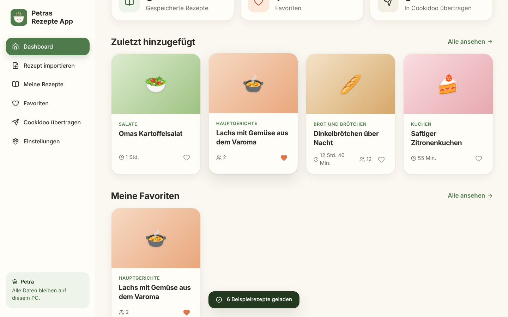
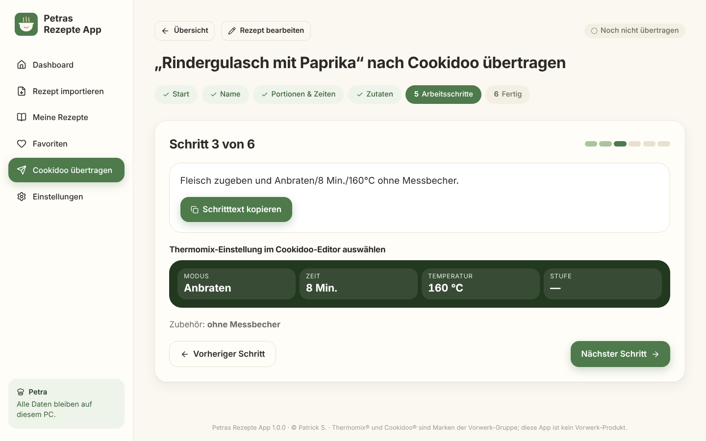

# 🍲 Petras Rezepte App

Rezepte aus dem **Zaubertopf Club**, aus **PDFs**, **Word-Dateien**, **Fotos** oder **Webseiten** für den
**Thermomix TM6** aufbereiten, in einer eigenen Rezeptbibliothek verwalten und mit einem geführten
Assistenten in **Cookidoo → Meine Kreationen** übertragen.

Windows-Anwendung · läuft im Google-Chrome-Fenster · alle Daten bleiben lokal · © Patrick S.



---

## Für Petra: Installation & Bedienung

### Installieren
1. `PetrasRezepteApp-Setup-1.0.0.exe` doppelt anklicken.
2. Falls Windows „Der Computer wurde durch Windows geschützt“ meldet: **Weitere Informationen → Trotzdem ausführen**
   (die Datei ist nicht digital signiert – siehe unten).
3. „Weiter“ → Lizenz bestätigen → **Fertig**. Es sind **keine Administratorrechte** nötig.
4. Auf dem Desktop erscheint **„Petras Rezepte App“**.

Die App öffnet sich als eigenes Fenster in **Google Chrome** (falls Chrome fehlt: Microsoft Edge).

### Ein Rezept übernehmen
| | |
|---|---|
| **1. Importieren** | „Rezept importieren“ → Text aus dem Zaubertopf Club einfügen **oder** PDF hineinziehen. PDF erzeugen: im Browser **Strg + P → „Als PDF speichern“**. Auch Word (.docx), TXT und Fotos/Scans (Texterkennung) gehen. |
| **2. Prüfen** | Die App erkennt Name, Portionen, Zeiten, Zutaten (Menge · Einheit · Zutat), Schritte und Thermomix-Einstellungen. **Grüne Knöpfe** stehen so im Rezept. **Gestrichelte Knöpfe** sind *Vorschläge* der App – sie gelten erst nach „Übernehmen“. Ein Klick auf einen Knopf öffnet die Einstellung zum Ändern (Zeit, Temperatur, Stufe, Linkslauf, Teig, Anbraten, Turbo, Varoma). |
| **3. Speichern** | Das Rezept landet in „Meine Rezepte“. Alles wird zusätzlich **automatisch zwischengespeichert**. |
| **4. Cookidoo** | „Speichern & zu Cookidoo“ → der Assistent öffnet Cookidoo und zeigt Schritt für Schritt, was wohin gehört – jeder Text mit **Kopieren**-Knopf, die Thermomix-Werte groß wie am Display. |
| **5. Am TM6** | Cookidoo → Meine Rezepte → **Meine Kreationen** → Rezept starten. |




### Noch schneller: Lesezeichen „➜ Petras Rezepte“
Einstellungen → Cookidoo → den grünen Knopf in die Lesezeichenleiste ziehen (Leiste einblenden: **Strg + Umschalt + B**).
Auf einer Rezeptseite anklicken → in der App **„Aus Zwischenablage einfügen“**.

### Daten, Sicherung, Update, Deinstallation
* Rezepte liegen in `%APPDATA%\Petras Rezepte App` (Datenbank `rezepte.db`).
* **Tägliche automatische Sicherung** (die letzten 20), manuell unter Einstellungen → Datensicherung; dort auch
  Wiederherstellen, **Export aller Rezepte** (.json) und Import. Gelöschte Rezepte bleiben 30 Tage im **Papierkorb**.
* **Update:** neue Setup-Datei starten – Rezepte bleiben erhalten.
* **Deinstallieren:** Windows-Einstellungen → Apps → Petras Rezepte App. Rezepte werden **nur** gelöscht, wenn du es ausdrücklich bestätigst.
* Die App beendet sich von selbst ~20 Minuten nach dem Schließen des Fensters (oder Einstellungen → „App beenden“).

---

## Cookidoo: Was geht automatisch – und was nicht?

Ausführlich in **[docs/MACHBARKEIT.md](docs/MACHBARKEIT.md)**. Kurz:

* Vorwerk bietet **keine offizielle Cookidoo-Schnittstelle** an. Offiziell gibt es nur den Web-Editor „Meine Kreationen“
  und den Import per URL (nur öffentliche Seiten – Zaubertopf-Club-Rezepte liegen hinter einem Login).
* **Standard: geführter Übertragungsassistent** – nutzt ausschließlich die normale Cookidoo-Webseite.
  *Automatisch:* Aufbereitung, Kopieren, Cookidoo öffnen. *Petra bestätigt:* Einfügen, Einstellungen auswählen, Speichern.
* **Optional: „Schnellübertragung (experimentell)“** – standardmäßig **aus**, muss in den Einstellungen bewusst
  eingeschaltet werden (mit Hinweis). Befüllt „Meine Kreationen“ per Lesezeichen in Petras angemeldetem Chrome über
  dieselbe (nicht dokumentierte) Schnittstelle, die die Cookidoo-Webseite selbst nutzt. Kein Passwort, kein fremder Server,
  3–5 Anfragen pro Rezept.
* Die App speichert **niemals** Cookidoo-Zugangsdaten.

## Optionale KI
Einstellungen → KI: eigener **Claude-API-Schlüssel** (Anthropic, kostenpflichtig pro Nutzung). Der Schlüssel wird mit der
Windows-Datenschutz-API (DPAPI) verschlüsselt gespeichert und nie angezeigt; gesendet wird nur der Rezepttext.
KI-Ergebnisse sind immer **Vorschläge**. Ohne KI funktioniert alles kostenlos.

---

## Für Entwickler

### Architektur
```
 Chrome-Fenster (--app)                  PetrasRezepteApp.exe (Node.js „Single Executable“)
 ┌──────────────────────────┐  HTTP     ┌───────────────────────────────────────────────┐
 │ React + TypeScript +     │ 127.0.0.1 │ server/  API, Sicherheit (Token, Host/Origin)  │
 │ Tailwind (web/)          │ ◄───────► │ SQLite (node:sqlite) · Sicherungen · Protokoll │
 │ PDF: pdf.js · OCR: Tess- │  + Token  │ DPAPI-Schlüsselablage · optionale Claude-API   │
 │ eract (deu) · Word: mam. │           │ eingebettete Oberfläche (SEA-Assets)           │
 └──────────────────────────┘           └───────────────────────────────────────────────┘
          shared/  Rezeptanalyse, Thermomix-Einstellungen, Zutaten, Vorschläge, Prüfung, Cookidoo-Format
          helper/  Lesezeichen „➜ Petras Rezepte“ (Rezept holen · experimentelle Schnellübertragung)
```
Warum diese Lösung (statt Electron/Tauri/PWA): siehe [docs/MACHBARKEIT.md](docs/MACHBARKEIT.md#2-windows-architektur).

### Ordner
| Ordner | Inhalt |
|---|---|
| `shared/` | Datenmodell, Parser, TM-Einstellungen (`tm.ts`), Zutaten, Vorschläge, Validierung, Cookidoo-Format, PDF-Zeilen |
| `server/` | lokaler Dienst: `main.ts`, `api.ts`, `db.ts`, `backup.ts`, `security.ts`, `secrets.ts`, `ai.ts`, `launcher.ts` |
| `web/` | Oberfläche (Vite, React 19, Tailwind 4) – Seiten in `web/src/pages` |
| `helper/` | Lesezeichen (wird zu `web/dist/helper/bookmarklet.js` gebaut) |
| `build/` | Build-Skripte, NSIS-Installer, Symbol, Lizenzsammlung |
| `samples/` | eigene Testrezepte + `beispiel-datenbank.db` |
| `tests/` | Unit-/Integrationstests (`node:test`) und E2E (`tests/e2e`) |

### Befehle (Node.js ≥ 22.13)
```bash
npm install
npm run build          # Oberfläche + Lesezeichen + Dienst → dist/
npm start              # Dienst starten (öffnet Chrome); --no-browser zum Testen
npm run dev            # Entwicklung: Dienst (Port 47123) + Vite (Port 5173)
npm test               # 28 Unit-/Integrationstests
npm run test:e2e       # Browser-Ende-zu-Ende-Test (Playwright, benötigt Chromium)
npm run typecheck
npm run dist:win       # Windows-EXE + Installer → release/  (benötigt makensis, unzip)
npx tsx build/make-samples.ts   # Beispielrezepte/-datenbank neu erzeugen
```
Umgebungsvariablen für Tests: `PRA_DATA_DIR`, `PRA_PORT`, `PRA_TOKEN`, `PRA_NO_BROWSER`, `PRA_IDLE_MINUTES`.

### Qualität & Sicherheit
* Eingabeprüfung im Dienst (Größenlimits, Typen, erlaubte Cookidoo-Adressen), verständliche Fehlermeldungen.
* Automatische Zwischenspeicherung (Entwurf), Papierkorb, tägliche Sicherung, Sicherung vor jeder Wiederherstellung.
* Protokoll `logs/app.log` ohne Rezeptinhalte; Schlüssel/Passwörter werden herausgefiltert.
* Doppelte Rezepte werden beim Speichern und Import erkannt; Mengen/Einheiten/TM6-Grenzwerte werden geprüft.
* Mehrere Profile mit getrennten Rezepten und Einstellungen; keine fest eingebauten Zugangsdaten.

### Stand der Tests
* ✅ 28 Unit-/Integrationstests (Parser, Zutaten, TM-Einstellungen, Vorschläge, 6 Testrezepte, Dienst inkl. Sicherheit,
  Sicherung/Wiederherstellung, Verschlüsselung, Protokoll).
* ✅ E2E im Browser – auch gegen die **gepackte** Single-Executable: mehrseitige PDF mit Kopf-/Fußzeilen, PDF mit Tabelle
  und Bild, **gescannte PDF (OCR)**, Text-Import → Vorschlag → Speichern → Bibliothek → Favorit → Assistent.
* ✅ Lesezeichen gegen nachgebaute Zaubertopf-/Cookidoo-Seiten.
* ⚠️ **Noch nicht auf echtem Windows getestet** (Build entsteht unter Linux; Struktur der EXE und Inhalt des Installers
  sind geprüft). Ebenfalls ungetestet: echtes cookidoo.de, echte Zaubertopf-Seiten, KI mit echtem Schlüssel.

### Veröffentlichung (später)
* Code-Signing-Zertifikat besorgen und EXE + Installer signieren (verhindert die SmartScreen-Warnung).
* Lizenz (`LICENSE.txt`) und Hinweise zu Marken/Urheberrecht prüfen lassen.
* Update-Prüfung: Versionsdatei auf eigenem Server/GitHub-Releases abfragen (vorbereitet über `APP_VERSION`).
