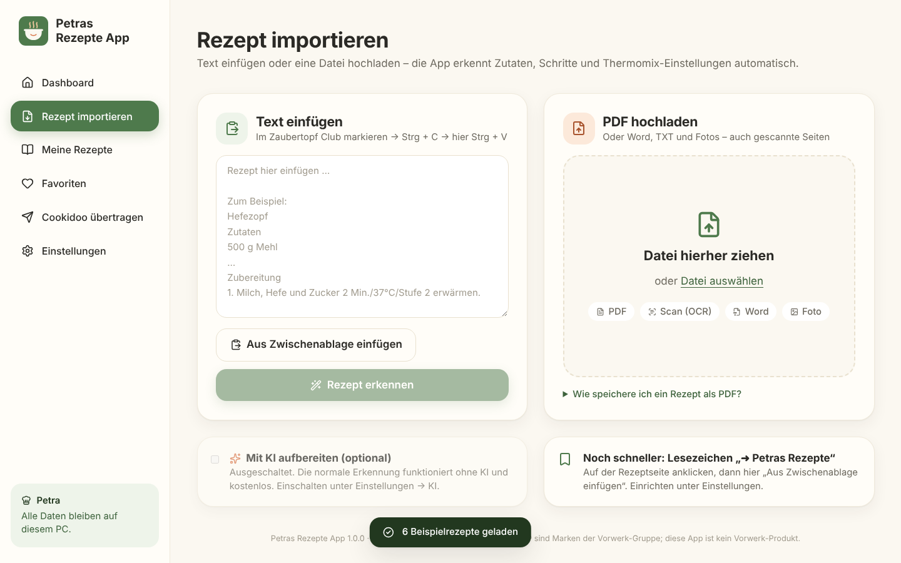
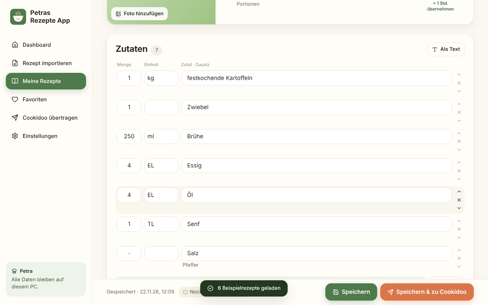

# 🍲 Petras Rezepte App

Rezepte aus dem **Zaubertopf Club**, aus **PDFs**, **Word-Dateien**, **Fotos** oder **Webseiten** für den
**Thermomix TM6** aufbereiten, in einer eigenen Rezeptbibliothek verwalten und mit einem geführten
Assistenten in **Cookidoo → Meine Kreationen** übertragen.

Windows-Anwendung · läuft im Google-Chrome-Fenster · funktioniert offline · optional synchronisiert zwischen PC und
Notebook · © Patrick S.

## Neu in Version 2.0
* **Rezeptdatei hochladen** als Hauptweg: Zaubertopf-Club-Seite mit **Strg + S** speichern und hochladen – HTML, PDF,
  Word (.docx/.doc), TXT oder Bild (JPG/PNG, Texterkennung). Das Rezeptbild wird mit übernommen.
* **5-Schritte-Anleitung** direkt auf der Importseite (Zaubertopf Club öffnen → speichern → hochladen → prüfen →
  nach Cookidoo), mit Häkchen für erledigte Schritte.
* **Synchronisierung PC ↔ Notebook** (kostenlos über ein eigenes Firebase-Projekt): Rezepte, Bilder, Kategorien,
  Favoriten, Notizen, Löschungen; offline weiterarbeiten; gleichzeitige Änderungen gehen nie verloren
  (Konflikt-Kopie); **Versionsverlauf** je Rezept; Geräteverwaltung.
* **Cookidoo-Assistent** mit Fortschritt je Feld („was ist übertragen, was fehlt“), „Alle Schritte kopieren“ und
  **„Cookidoo nebenan öffnen“** (beide Fenster nebeneinander, kein Fenstersuchen).
* **Kategorien verwalten** (eigene Kategorien, umbenennen, sortieren), Prüfung auf Zutaten, die in keinem Schritt
  vorkommen, optionale **KI-Prüfung** im Editor (Beschreibung, Unstimmigkeiten, TM-Vorschläge – nur als Vorschlag).

**Anleitungen:** [Installation](docs/INSTALLATION.md) · [Synchronisierung einrichten](docs/SYNC-ANLEITUNG.md) ·
[Zweites Gerät](docs/ZWEITES-GERAET.md) · [Kosten](docs/KOSTEN.md) · [Architektur](docs/ARCHITEKTUR.md) ·
[Testprotokoll](docs/TESTS.md)


---

## Für Petra: Installation & Bedienung

### Installieren
1. `PetrasRezepteApp-Setup-2.0.0.exe` doppelt anklicken (Download: Ordner `download/`).
2. Falls Windows „Der Computer wurde durch Windows geschützt“ meldet: **Weitere Informationen → Trotzdem ausführen**
   (die Datei ist nicht digital signiert – siehe unten).
3. „Weiter“ → Lizenz bestätigen → **Fertig**. Es sind **keine Administratorrechte** nötig.
4. Auf dem Desktop erscheint **„Petras Rezepte App“**.

Die App öffnet sich als eigenes Fenster in **Google Chrome** (falls Chrome fehlt: Microsoft Edge).

### Ein Rezept übernehmen
| | |
|---|---|
| **1. Importieren** | „Rezept importieren“ → **„Öffne den Zaubertopf Club“** → Rezept öffnen → **Strg + S** („Webseite, vollständig“) → die gespeicherte Datei (oder ganzen Ordner) in die App ziehen → **„Rezept jetzt erkennen“**. Ebenso: PDF, Word (.docx/.doc), TXT, Fotos/Scans (Texterkennung). Alternativ Link oder Text einfügen. |
| **2. Prüfen** | Die App erkennt Name, Portionen, Zeiten, Zutaten (Menge · Einheit · Zutat), Schritte und Thermomix-Einstellungen. **Grüne Knöpfe** stehen so im Rezept. **Gestrichelte Knöpfe** sind *Vorschläge* der App – sie gelten erst nach „Übernehmen“. Ein Klick auf einen Knopf öffnet die Einstellung zum Ändern (Zeit, Temperatur, Stufe, Linkslauf, Teig, Anbraten, Turbo, Varoma). |
| **3. Speichern** | Das Rezept landet in „Meine Rezepte“. Alles wird zusätzlich **automatisch zwischengespeichert**. |
| **4. Cookidoo** | „Speichern & zu Cookidoo“ → **Ausfüllhilfe starten** (empfohlen, siehe unten) – oder der Schritt-für-Schritt-Assistent mit **Kopieren**-Knöpfen und großen Thermomix-Werten. |
| **5. Am TM6** | Cookidoo → Meine Rezepte → **Meine Kreationen** → Rezept starten. |





### Rezept per Link (neu in 1.1)
„Rezept importieren“ → **Link einfügen** → „Rezept holen“.
* **Öffentliche Rezeptseiten** liest die App direkt.
* **ZauberTopf Club:** Die Zubereitung ist nur für angemeldete Mitglieder sichtbar. Die App öffnet die Seite deshalb in
  deinem angemeldeten Chrome → dort auf das Lesezeichen **„➜ Petras Rezepte“** → „Für die App kopieren“ → zurück zur App,
  sie übernimmt das Rezept **automatisch**. Gelesen werden Zutaten mit Gruppen, alle Schritte, die Club-Schreibweise
  („10 Sek. | Stufe 4“) und zum Abgleich der **Kochmodus**. Verlinkte **Teilrezepte** (z. B. selbst gemachter Frischkäse)
  können per Häkchen gleich mitgeholt werden.
* **Gespeicherte Seite:** Rezeptseite angemeldet mit **Strg + S** speichern und die .html-Datei in die App ziehen.
* Die App speichert **kein** Club-Passwort.

### Schritte aus dem Kochmodus (neu in 1.3)
Hat ein Club-Rezept einen **Kochmodus**, baut die App die Schritte daraus – in der Reihenfolge, in der man am Thermomix
arbeitet, mit genau **einer Einstellung pro Schritt** und den **Zutaten des Schritts**, z. B.
„125 g Parmesan, in Stücken in den Mixtopf geben und 10 Sek./Stufe 10 zerkleinern. Umfüllen.“
* Die Zutaten werden in Cookidoo als **Zutat im Schritt** markiert (`<cr-ingredient>`) – der TM6 zeigt sie im Schritt mit Menge an.
* Der **Originaltext** der Seite bleibt erhalten: im Editor mit „⇄ Originaltext verwenden“ umschalten.
* Wohin eine Zutat kommt (Mixtopf/Varoma/Gareinsatz), entnimmt die App dem Originaltext; ist es unklar, heißt es neutral „zugeben“.

### Ausfüllhilfe für den Cookidoo-Editor (neu in 1.2)
Das Lesezeichen **„➜ Petras Rezepte“** füllt den Cookidoo-Editor über dessen normale Oberfläche aus:
1. In der App: „Cookidoo übertragen“ → **„Ausfüllhilfe starten“** (Cookidoo öffnet sich bei „Meine Kreationen“).
2. Lesezeichen → **„Rezept in Cookidoo anlegen“** – trägt den Namen in Cookidoos Dialog ein (warnt, wenn es den Namen schon gibt).
3. Im Editor: Lesezeichen → **„Weiter zu Zutaten & Rezeptschritte“** (Portionen/Zeiten werden zum Eintragen angezeigt).
4. Lesezeichen → **„Zutaten & Schritte eintragen“** – jede Zutat und jeder Schritt wird nacheinander eingetragen und mit
   Cookidoos ✓ gespeichert; Zeit · Temperatur · Stufe · Linkslauf als echter Thermomix-Knopf (`<cr-tts>`, wie im Editor).
   Modi wie Teig, Turbo oder Anbraten meldet die Hilfe zum Ergänzen über „Koch-Einstellungen“. Danach „Bestätigen“.

### Noch schneller: Lesezeichen „➜ Petras Rezepte“
Einstellungen → Cookidoo → den grünen Knopf in die Lesezeichenleiste ziehen (Leiste einblenden: **Strg + Umschalt + B**).
Auf einer Rezeptseite anklicken → in der App **„Aus Zwischenablage einfügen“**.

### PC und Notebook synchron halten (neu in 2.0)
Einmalig ein kostenloses Firebase-Projekt anlegen ([Anleitung](docs/SYNC-ANLEITUNG.md), ca. 10 Minuten, **keine
Zahlungsart nötig**), in der App unter **Einstellungen → Geräte und Synchronisierung** eintragen und ein Konto
erstellen. Am Notebook den **Verbindungscode** eingeben und mit demselben Konto anmelden ([Anleitung](docs/ZWEITES-GERAET.md)).
Links unten zeigt die App den Status: *Synchronisiert* · *Synchronisierung läuft* · *Offline – Änderungen lokal
gespeichert* · *Synchronisierung fehlgeschlagen* – mit **„Jetzt synchronisieren“**.

### Daten, Sicherung, Update, Deinstallation
* Rezepte liegen in `%APPDATA%\Petras Rezepte App` (Datenbank `rezepte.db`).
* **Tägliche automatische Sicherung** (die letzten 20), manuell unter Einstellungen → Datensicherung; dort auch
  Wiederherstellen, **Export aller Rezepte** (.json) und Import. Gelöschte Rezepte bleiben 30 Tage im **Papierkorb**.
* **Update:** neue Setup-Datei starten – Rezepte bleiben erhalten.
* **Deinstallieren:** Windows-Einstellungen → Apps → Petras Rezepte App. Rezepte werden **nur** gelöscht, wenn du es ausdrücklich bestätigst.
* Die App beendet sich von selbst ~20 Minuten nach dem Schließen des Fensters (oder Einstellungen → „App beenden“).

---

## Cookidoo: Was geht automatisch – und was nicht?

Ausführlich in **[docs/MACHBARKEIT.md](docs/MACHBARKEIT.md)**. Kurz:

* Vorwerk bietet **keine offizielle Cookidoo-Schnittstelle** an. Offiziell gibt es nur den Web-Editor „Meine Kreationen“
  und den Import per URL (nur öffentliche Seiten – Zaubertopf-Club-Rezepte liegen hinter einem Login).
* **Standard: geführter Übertragungsassistent** – nutzt ausschließlich die normale Cookidoo-Webseite.
  *Automatisch:* Aufbereitung, Kopieren, Cookidoo öffnen. *Petra bestätigt:* Einfügen, Einstellungen auswählen, Speichern.
* **Optional: „Schnellübertragung (experimentell)“** – standardmäßig **aus**, muss in den Einstellungen bewusst
  eingeschaltet werden (mit Hinweis). Befüllt „Meine Kreationen“ per Lesezeichen in Petras angemeldetem Chrome über
  dieselbe (nicht dokumentierte) Schnittstelle, die die Cookidoo-Webseite selbst nutzt. Kein Passwort, kein fremder Server,
  3–5 Anfragen pro Rezept.
* Die App speichert **niemals** Cookidoo-Zugangsdaten.

## Optionale KI
Einstellungen → KI: eigener **Claude-API-Schlüssel** (Anthropic, kostenpflichtig pro Nutzung). Der Schlüssel wird mit der
Windows-Datenschutz-API (DPAPI) verschlüsselt gespeichert und nie angezeigt; gesendet wird nur der Rezepttext.
KI-Ergebnisse sind immer **Vorschläge**. Ohne KI funktioniert alles kostenlos.

---

## Für Entwickler

### Architektur
```
 Chrome-Fenster (--app)                  PetrasRezepteApp.exe (Node.js „Single Executable“)
 ┌──────────────────────────┐  HTTP     ┌───────────────────────────────────────────────┐
 │ React + TypeScript +     │ 127.0.0.1 │ server/  API, Sicherheit (Token, Host/Origin)  │
 │ Tailwind (web/)          │ ◄───────► │ SQLite (node:sqlite) · Sicherungen · Protokoll │
 │ PDF: pdf.js · OCR: Tess- │  + Token  │ DPAPI-Schlüsselablage · optionale Claude-API   │
 │ eract (deu) · Word: mam. │           │ eingebettete Oberfläche (SEA-Assets)           │
 └──────────────────────────┘           └───────────────────────────────────────────────┘
          shared/  Rezeptanalyse, Thermomix-Einstellungen, Zutaten, Vorschläge, Prüfung, Cookidoo-Format
          helper/  Lesezeichen „➜ Petras Rezepte“ (Rezept holen · experimentelle Schnellübertragung)
```
Warum diese Lösung (statt Electron/Tauri/PWA): siehe [docs/MACHBARKEIT.md](docs/MACHBARKEIT.md#2-windows-architektur).

### Ordner
| Ordner | Inhalt |
|---|---|
| `shared/` | Datenmodell, Parser, TM-Einstellungen (`tm.ts`), Zutaten, Vorschläge, Validierung, Cookidoo-Format, PDF-Zeilen, Seitenleser (`sites/`: ZauberTopf Club, allgemein) |
| `server/` | lokaler Dienst: `main.ts`, `api.ts`, `db.ts`, `backup.ts`, `security.ts`, `secrets.ts`, `ai.ts`, `launcher.ts`, `fetch-url.ts` |
| `server/sync/` | Synchronisierung: `firebase.ts` (REST-Client Auth/Firestore), `engine.ts` (Abgleich, Konflikte, Geräte) |
| `firebase/` | Sicherheitsregeln `firestore.rules`, Emulator-Konfiguration für Tests |
| `web/` | Oberfläche (Vite, React 19, Tailwind 4) – Seiten in `web/src/pages` |
| `helper/` | Lesezeichen (wird zu `web/dist/helper/bookmarklet.js` gebaut) |
| `build/` | Build-Skripte, NSIS-Installer, Symbol, Lizenzsammlung |
| `samples/` | eigene Testrezepte + `beispiel-datenbank.db` |
| `tests/` | Unit-/Integrationstests (`node:test`) und E2E (`tests/e2e`) |

### Befehle (Node.js ≥ 22.13)
```bash
npm install
npm run build          # Oberfläche + Lesezeichen + Dienst → dist/
npm start              # Dienst starten (öffnet Chrome); --no-browser zum Testen
npm run dev            # Entwicklung: Dienst (Port 47123) + Vite (Port 5173)
npm test               # 42 Unit-/Integrationstests
npm run test:sync      # Synchronisierung: 10 Szenarien gegen Firebase-Emulatoren (Java 21; kein Konto, keine Kosten)
node build/sync-test.mjs --ui   # Synchronisierung in der Oberfläche (zwei Geräte)
node tests/e2e/link-import.cjs  # E2E: Link einfügen, Lesezeichen, gespeicherte Seiten
node tests/e2e/cookidoo-fill.cjs # E2E: Ausfüllhilfe gegen nachgebauten Cookidoo-Editor
npm run test:e2e       # Browser-Ende-zu-Ende-Test (Playwright, benötigt Chromium)
npm run typecheck
npm run dist:win       # Windows-EXE + Installer → release/  (benötigt makensis, unzip)
npx tsx build/make-samples.ts   # Beispielrezepte/-datenbank neu erzeugen
```
Umgebungsvariablen für Tests: `PRA_DATA_DIR`, `PRA_PORT`, `PRA_TOKEN`, `PRA_NO_BROWSER`, `PRA_IDLE_MINUTES`,
`PRA_ALLOW_EMULATOR=1` (nur Tests: Firebase-Emulatoren erlauben). Ausführliche Architektur: [docs/ARCHITEKTUR.md](docs/ARCHITEKTUR.md).

### Qualität & Sicherheit
* Eingabeprüfung im Dienst (Größenlimits, Typen, erlaubte Cookidoo-Adressen), verständliche Fehlermeldungen.
* Automatische Zwischenspeicherung (Entwurf), Papierkorb, tägliche Sicherung, Sicherung vor jeder Wiederherstellung.
* Protokoll `logs/app.log` ohne Rezeptinhalte; Schlüssel/Passwörter werden herausgefiltert.
* Doppelte Rezepte werden beim Speichern und Import erkannt; Mengen/Einheiten/TM6-Grenzwerte werden geprüft.
* Mehrere Profile mit getrennten Rezepten und Einstellungen; keine fest eingebauten Zugangsdaten.

### Stand der Tests
Vollständiges Protokoll der Tests 1–13 aus dem Auftrag: **[docs/TESTS.md](docs/TESTS.md)**.
* ✅ 42 Unit-/Integrationstests, 4 Oberflächen-Testreihen (Import inkl. OCR, Link/Lesezeichen, Ausfüllhilfe, Sync mit zwei Geräten).
* ✅ Synchronisierung gegen die offiziellen Firebase-Emulatoren: erstes Hochladen, zweites Gerät, Änderungen in beide
  Richtungen, offline, Konflikt, Löschen, Kategorien, Bilder nur bei Änderung, Sicherheitsregeln, Geräte entfernen.
* ✅ Datenbank-Update 1.3 → 2.0 (automatische Sicherung vorher).
* ⚠️ **Noch nicht auf echtem Windows getestet** (Build entsteht unter Linux). Ebenfalls ungetestet: echtes cookidoo.de-Speichern
  im Editor, echtes Firebase-Projekt (nur Emulatoren), KI mit echtem Schlüssel. Checkliste in docs/TESTS.md.

### Veröffentlichung (später)
* Code-Signing-Zertifikat besorgen und EXE + Installer signieren (verhindert die SmartScreen-Warnung).
* Lizenz (`LICENSE.txt`) und Hinweise zu Marken/Urheberrecht prüfen lassen.
* Update-Prüfung: Versionsdatei auf eigenem Server/GitHub-Releases abfragen (vorbereitet über `APP_VERSION`).
